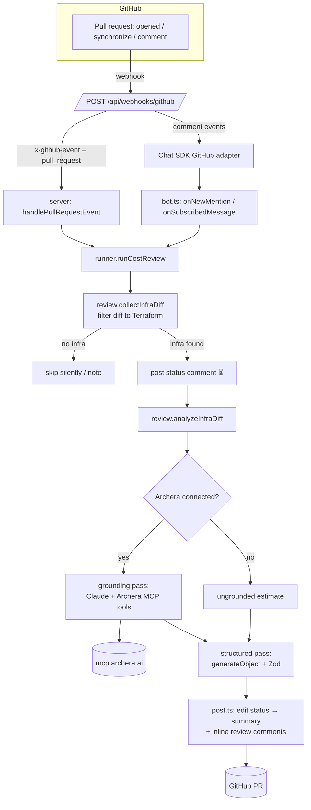
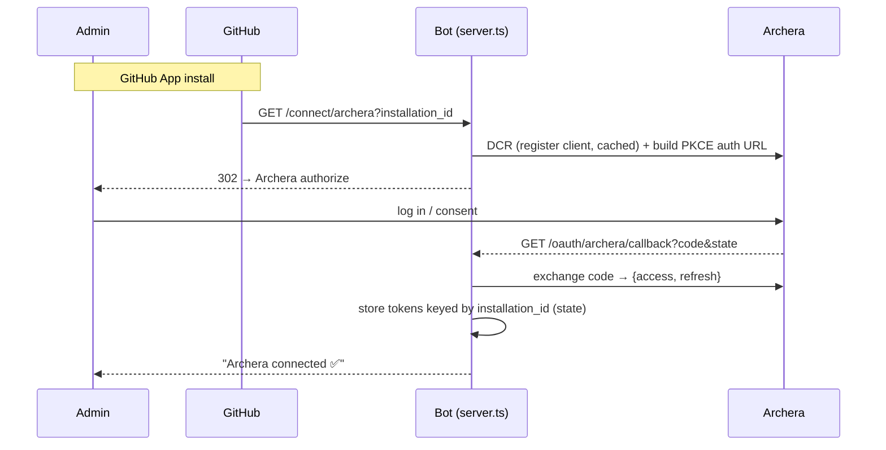

# GitHub Cloud-Cost Review Bot — Design

A GitHub App that reviews pull requests for **cloud-cost impact**. When a PR
changes infrastructure-as-code, the bot analyzes the diff with Claude — grounded
in the customer's **real Archera pricing and savings data** — and posts a
Greptile-style review: inline comments on the cost-relevant lines (with severity
and committable suggestions) plus a summary report.

Status: working proof-of-concept. End-to-end verified locally (auto-review on PR
events, `@mention` reviews, Archera OAuth connect, and a grounded review using
live Archera data over MCP).

---

## 1. Goals & non-goals

**Goals**
- Catch cloud-cost increases *before merge*, in the PR, where the author is.
- Ground cost estimates in real data (Archera), not the model's pricing guesses.
- Multi-tenant: one running service serves many companies, each using their own
  Archera org.
- Low noise: only act on PRs that touch infrastructure.

**Non-goals (today)**
- Whole-codebase/cross-file reasoning (we review the diff only).
- Non-Terraform IaC (the filter is pluggable but only Terraform is enabled).
- A hosted UI/dashboard (onboarding is a redirect + a couple of HTML pages).
- Per-tenant billing, quotas, or isolation guarantees.

---

## 2. Component map

| File | Responsibility | Key dependency |
|------|----------------|----------------|
| `src/server.ts` | Hono HTTP server. Routes webhooks and the OAuth connect/callback. | `hono`, `@hono/node-server` |
| `src/bot.ts` | Chat SDK instance + GitHub adapter; `@mention` handlers. | `chat`, `@chat-adapter/github` |
| `src/github-app.ts` | Installation-token Octokit (for the `pull_request` path) + webhook signature verification. | `@octokit/rest`, `@octokit/auth-app` |
| `src/runner.ts` | Orchestrates one review: filter → status comment → analyze → post. | — |
| `src/review.ts` | `collectInfraDiff` (fetch+filter, no LLM) and `analyzeInfraDiff` (LLM). Zod schema, prompts, Archera grounding pass. | `ai`, `@ai-sdk/anthropic`, `zod` |
| `src/infra.ts` | Which files count as infra (Terraform today); filter a diff to them. | — |
| `src/diff.ts` | Split a diff by file, find commentable lines, annotate lines with numbers. | — |
| `src/render.ts` | Markdown for the summary report and inline findings. | — |
| `src/post.ts` | Post the bundled GitHub review + the in-progress→summary status comment. | `@octokit/rest` |
| `src/archera.ts` | Connect to Archera's MCP server, expose curated tools to the model. | `@modelcontextprotocol/sdk`, `ai` |
| `src/archera-oauth.ts` | Per-installation Archera OAuth (Authorization Code + PKCE) with Dynamic Client Registration; token storage + refresh. | `@modelcontextprotocol/sdk` (auth) |
| `src/store.ts` | One shared state instance (Redis or in-memory), connected once. | `@chat-adapter/state-redis`/`-memory` |
| `src/log.ts` | Opt-in review tracing (`REVIEW_DEBUG`). | node `fs` |
| `src/env.ts` | Required-env helpers. | — |

**Runtime stack:** Node ≥20 (ESM), TypeScript, Hono server, Vitest + Biome.
Pinned majors: `chat@4`, `@chat-adapter/*@4`, `ai@6`, `@ai-sdk/anthropic@3`,
`@modelcontextprotocol/sdk@1`, `@octokit/rest@22`, `@octokit/auth-app@8`, `zod@3`.

---

## 3. Architecture

---

## 4. How a review runs (end-to-end)

1. **Webhook in.** GitHub POSTs to `/api/webhooks/github`. The server branches on
   the `x-github-event` header (reading headers does not consume the body):
   - `pull_request` → handled directly (the Chat SDK adapter ignores these). The
     server verifies the HMAC signature, ignores drafts and non-reviewable
     actions, mints an installation-scoped Octokit, and runs the review in the
     background after a fast `200` ack.
   - `issue_comment` / `pull_request_review_comment` → handed to the Chat SDK
     adapter, which does signature verification + mention detection and calls the
     `onNewMention` / `onSubscribedMessage` handlers.
2. **Filter (cheap).** `collectInfraDiff` fetches the PR diff
   (`pulls.get` with `format: diff`) and keeps only infra files (Terraform). If
   none, the run ends — silently on the auto path, with a short note on `@mention`.
3. **Status comment.** A `⏳ Reviewing…` comment is posted immediately so the PR
   shows activity (CodeRabbit-style placeholder).
4. **Grounding (optional).** If the installation has connected Archera,
   `analyzeInfraDiff` opens an MCP connection as that tenant and runs an agentic
   `generateText` pass: Claude calls Archera tools (catalog prices, SKU offers,
   savings) for the resources in the diff and writes down the real numbers.
5. **Structure.** `generateObject` + a Zod schema turns the diff (+ grounding
   notes) into a typed review: verdict, confidence, estimated monthly delta,
   per-file notes, and findings `{path, line, severity, body, suggestion?}`.
6. **Post.** The `⏳` comment is edited into the summary report; inline findings
   are posted as one bundled GitHub review, anchored to lines validated against
   the diff. Findings whose line can't be matched fold into the summary so
   nothing is lost.

---

## 5. Key design decisions

| Decision | Why | Alternatives considered |
|----------|-----|-------------------------|
| **Chat SDK + GitHub adapter** | One framework for webhooks, signature checks, mention detection, multi-tenant installation resolution. | Raw Octokit webhooks; Probot. |
| **Multi-tenant GitHub App** | One process serves many orgs; installation resolved per webhook (the adapter caches a client per installation via `AsyncLocalStorage`). | Single-tenant fixed installation (simpler, doesn't scale to customers). |
| **Own handler for `pull_request` events** | The Chat SDK adapter only handles comment events, so auto-review on open/push is built directly in `server.ts` with its own signature check + installation token. | Only `@mention` triggering (no auto-review). |
| **Diff-only context** | Cheap, fast, no repo clone/sandbox. Good enough for cost signals in IaC. | Agentic + Vercel Sandbox (reads surrounding files); full repo embeddings index (closest to Greptile, heavy infra). |
| **Infra-only filter (Terraform)** | Most PRs touch no infra; filtering avoids cost and review noise. Pluggable matchers in `infra.ts`. | Review everything (noisy, expensive). |
| **Structured output via `generateObject` + Zod** | Deterministic shape for rendering inline comments, severity, suggestions. | Free-text review (what the first version did). |
| **Inline review + status comment** | Matches Greptile/CodeRabbit UX: a single comment animates `⏳ → report`, inline findings as a bundled review. | Single big comment; ephemeral checks. |
| **Line annotation + validation** | Models are unreliable at line numbers; we prefix diff lines with their number and validate each finding against the diff, folding misses into the summary (avoids GitHub 422s). | Trust model line numbers (frequent 422s). |
| **Anthropic direct (`@ai-sdk/anthropic`)** | Works anywhere, no Vercel dependency; uses Claude. | Vercel AI Gateway (keyless on Vercel, ties to Vercel). |
| **Archera grounding via MCP** | The MCP server exposes pricing/savings tools directly; matches Archera's supported integration path and avoids hand-rolling REST endpoints. | Archera REST API with `x-api-key` (per-tenant key management, undocumented catalog endpoints). |
| **Per-installation OAuth + DCR** | Each company connects its own Archera org once at install; PKCE public client, no shared secret; DCR avoids manual client registration. | One global `ARCHERA_MCP_TOKEN` (kept as a local-testing fallback). |
| **Shared state (Redis/memory)** | Stores subscriptions, locks, **and Archera tokens** keyed by installation. | Separate stores; a real DB. |

---

## 6. State / data model

Stored in the shared state adapter (`store.ts`):

| Key | Value | Notes |
|-----|-------|-------|
| `archera:oauth:client` | `{ redirectUri, info }` (DCR registration) | One client; re-registered if `redirectUri` (PUBLIC_URL) changes. |
| `archera:oauth:flow:<state>` | `{ installationId, codeVerifier }` | TTL 10 min; carries PKCE verifier through the redirect. |
| `archera:oauth:tokens:<installationId>` | `{ access_token, refresh_token?, expires_at? }` | The per-tenant credential; refreshed on demand. |
| (Chat SDK) subscriptions / locks | adapter-managed | Per-thread. |

Secrets in env: `GITHUB_APP_ID`, `GITHUB_PRIVATE_KEY`, `GITHUB_WEBHOOK_SECRET`,
`ANTHROPIC_API_KEY`, optional `ARCHERA_MCP_TOKEN`, `PUBLIC_URL`, `REDIS_URL`.

---

## 7. Risks & what to address before production

### Blocking / high priority

1. **State durability.** Tokens, subscriptions, and the DCR client live in the
   shared state — which is **in-memory unless `REDIS_URL` is set**. A restart logs
   every customer out of Archera. **Action:** require Redis in production; treat
   memory state as dev-only. (We hit this during testing.)
2. **Anthropic rate limits & cost.** Reviews are token-heavy: a 100k-char diff is
   ~25k input tokens, re-sent across up to 8 agentic grounding steps, per PR.
   Tier-1 (30k input tokens/min) 429s immediately. **Action:** size the Anthropic
   tier to expected PR volume; add a per-installation queue + concurrency cap;
   consider a cheaper model (Haiku) for the grounding loop; trim `MAX_DIFF_CHARS`
   and the number of Archera tools; add real backoff that honors `retry-after`.
3. **Token security.** Archera access/refresh tokens are stored in plaintext in
   state. **Action:** encrypt at rest (KMS/secret manager), restrict Redis access,
   set TTLs, and support revocation/disconnect. Never log tokens.
4. **Prompt injection via diff.** PR content (and Archera tool output) flows into
   the model, which can call Archera tools. A malicious PR could try to steer the
   model. **Action:** treat the diff as untrusted; constrain tool scope
   (`archera:read` only — already done); never let the model take write actions;
   sanitize/limit tool outputs (we truncate to 8k); review the tool allowlist.
5. **Data egress / privacy.** PR diffs are sent to Anthropic, and resource details
   to Archera. **Action:** document this in customer terms; offer opt-out / private
   repos handling; confirm Anthropic data-retention/zero-retention posture; scrub
   obvious secrets from diffs before sending.
6. **Webhook reliability & idempotency.** We ack fast and process in the
   background; if the process dies mid-review, that event is lost (no retry/queue).
   `synchronize` fires on every push → repeated reviews / comment spam.
   **Action:** durable job queue with retries + dedupe; debounce rapid pushes;
   consider editing a single rolling review instead of posting a new one each push.

### Medium priority

7. **Least-privilege GitHub permissions.** Today: PRs R/W, Issues R/W, Contents
   read, Metadata read. Re-confirm each is needed; scope tightly.
8. **OAuth redirect rotation (ngrok/deploys).** `PUBLIC_URL` changing forces DCR
   re-registration and a GitHub Setup-URL update. **Action:** use a stable domain
   in production; the DCR client should register multiple/stable redirect URIs.
9. **Multi-tenant fairness/isolation.** One noisy org can exhaust shared Anthropic
   limits and the concurrency pool. **Action:** per-installation rate limiting and
   queues; per-tenant usage metering.
10. **Line-anchoring accuracy.** Findings whose line isn't in the diff fall back to
    the summary; large/edge-case diffs reduce inline precision. **Action:** monitor
    fold-back rate; consider multi-line ranges.
11. **MCP connection reliability.** Each review opens a fresh MCP connection;
    failures degrade to ungrounded (good) but add latency and can mislead if
    silent. **Action:** connection reuse/pooling, timeouts, and a visible
    "couldn't reach Archera" note instead of a silent estimate.
12. **Onboarding visibility.** Today a missing/expired connection silently falls
    back to estimates. **Action:** add a connection-status check and a lazy
    in-PR "Connect Archera →" nudge (designed, not yet built).
13. **Model/version drift & estimate quality.** Cost numbers depend on the model
    and on Archera coverage; ungrounded estimates can be wrong. **Action:** pin
    model versions, label estimates clearly (done in the footer), and add eval
    fixtures for representative IaC diffs.
14. **Mermaid diagram correctness.** The diagram is model-authored and can render
    as an error on GitHub. **Action:** validate/limit, or drop it.

### Lower priority / hygiene

15. **Observability.** `REVIEW_DEBUG` writes local JSON traces — fine for dev, not
    production. **Action:** structured logging + metrics (review latency, grounded
    rate, 429s, tool-call counts), error tracking, and per-tenant dashboards.
16. **Secrets in diffs / large diffs.** `MAX_DIFF_CHARS` truncation can cut context
    silently; truncation is marked but coverage drops.
17. **Testing gaps.** Unit tests cover the pure modules (diff parsing, infra filter,
    rendering, token freshness). The LLM passes, OAuth round-trip, and webhook
    handlers are not integration-tested. **Action:** add mocked end-to-end tests
    (canned diff → mocked Octokit + Archera + model → asserted review).
18. **Draft / bot-authored PRs & loops.** Drafts are skipped; ensure the bot never
    reviews its own comments (mention/self-detection via `GITHUB_BOT_USERNAME`).

---

## 8. Near-term planned changes (designed, not yet implemented)

These are scoped and ready to build; documented here so the design is complete.

### 8.1 Connection visibility: status endpoint + lazy connect-nudge
**Problem.** A missing or expired Archera connection currently degrades to an
ungrounded estimate *silently* — the only signals are the summary footer and the
debug trace. During testing this caused confusion (a review looked successful but
wasn't grounded, because the in-memory token was lost on restart).

**Planned.**
- `GET /connect/archera/status?installation_id=<id>` → returns connected /
  not-connected for that installation (backed by `isConnected()` in
  `archera-oauth.ts`, which already exists). Lets an admin verify before testing
  and gives a target for a future settings UI.
- **Lazy nudge.** When a review runs for an installation with no usable Archera
  token, post (or append to the summary) a one-line call to action —
  *"⚠️ Connect Archera for grounded prices → `<PUBLIC_URL>/connect/archera?installation_id=<id>`"* —
  instead of silently falling back. Thread the "was a token available" signal out
  of `connectArchera()`/`analyzeInfraDiff` so `runner.ts` can decide whether to nudge.

**Effort.** Small. One new route + a boolean threaded through the pipeline + a
render tweak. No new dependencies.

### 8.2 Make Redis the default / required in non-dev
**Problem.** `store.ts` falls back to in-memory state when `REDIS_URL` is unset, so
restarts wipe Archera tokens, subscriptions, and the DCR client registration. This
is the single most surprising failure mode (see Risk #1).

**Planned.**
- Treat in-memory as **dev-only**: if `NODE_ENV=production` (or a `REQUIRE_REDIS`
  flag) and `REDIS_URL` is unset, fail fast at startup with a clear error rather
  than silently using memory.
- Keep the in-memory fallback for local dev, but make the current warning louder
  and surface it in the connection-status response.

**Effort.** Small. A startup guard in `store.ts` + docs. No schema changes (keys
are already namespaced and Redis-compatible).

---

## 9. Roadmap (post-POC)

- **Deeper context:** agentic + sandbox (read referenced modules) or a repo index.
- **More IaC:** CloudFormation, Kubernetes/Helm, Pulumi, CDK (add `infra.ts` matchers).
- **Grounded math:** have the bot compute deltas from Archera prices deterministically
  rather than trusting the model to do arithmetic.
- **Connect UX:** status endpoint + lazy nudge + a small settings page; org picker.
- **Durability & scale:** Redis (required), a job queue, per-tenant rate limits.
- **Deploy:** host it (drop the tunnel), stable domain, secret manager.
